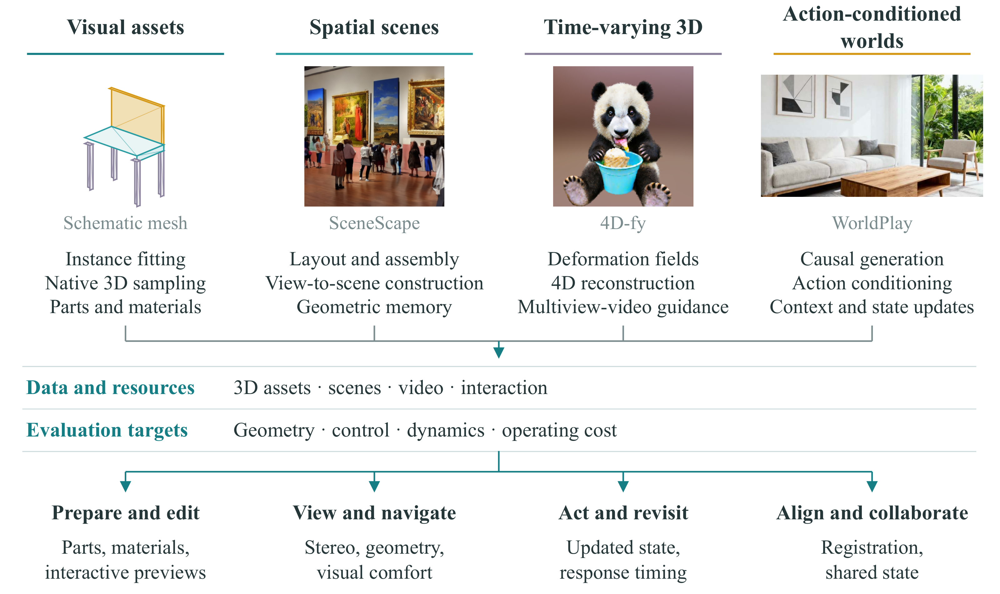
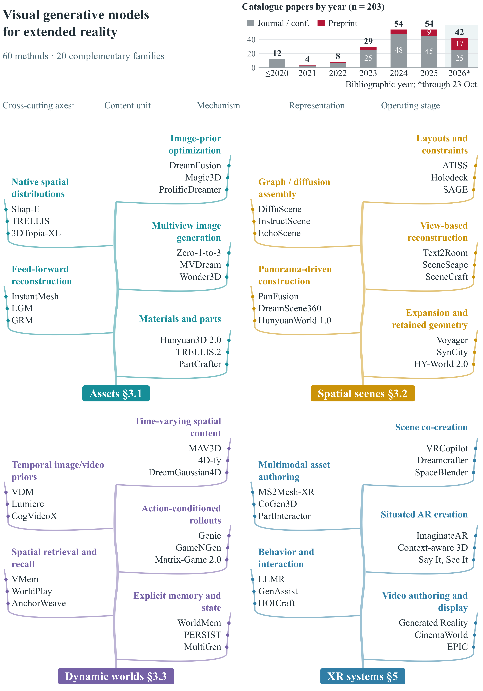

<div align="center">

# Visual Generative AI for Extended Reality

### A Survey of Assets, Scenes, Temporal Models, and XR Systems

**Guoxi Huang · Aston University**


[**Project website**](https://edhuang1.github.io/xr-survey/) · [**Full catalogue**](https://edhuang1.github.io/xr-survey/#collection) · [**Evidence supplement**](https://edhuang1.github.io/xr-survey/evidence/) · [**Bibliography**](docs/paper/references.bib)

</div>



Visual generative models create objects, spatial scenes, time-varying 3D content, and action-conditioned observations. This survey follows those outputs into **specific XR operations**: viewing, editing, retaining an accepted change, and responding to tracked input. It connects the representation a model produces to the components and evidence an XR application needs.

This repository accompanies *Visual Generative AI for Extended Reality: A Survey*. It provides a searchable project website, a structured catalogue, and source-linked evidence records. The manuscript and its source files remain outside the public repository. Targeted literature retrieval extends through **23 October 2026**.

The illustrated website includes four content-domain guides, an interactive method taxonomy, eight official video demonstrations, 12 attributed research figures, and an interactive spatial representation sandbox. It also includes table and detailed catalogue views, six featured resources, and five proposed XR evaluation designs. Videos load when visible, pause offscreen, and respect reduced-motion preferences. The page adapts to mobile screens and supports keyboard navigation. Video files stay on their official project hosts; the repository stores only credited full-frame posters and source metadata.

## Contents

- [At a glance](#at-a-glance)
- [Review framework](#review-framework)
- [Visual assets](#visual-assets)
- [Spatial scenes](#spatial-scenes)
- [Temporal generation and world models](#temporal-generation-and-world-models)
- [XR systems](#xr-systems)
- [Datasets, simulators, and benchmarks](#datasets-simulators-and-benchmarks)
- [Evidence and evaluation](#evidence-and-evaluation)
- [Citation](#citation)
- [Contributing and local preview](#contributing-and-local-preview)

## At a glance

| Catalogue | Entries | What it covers |
| :--- | ---: | :--- |
| Visual assets | **52** | Geometry, appearance, multiview generation, materials, parts, and mesh structure |
| Spatial scenes | **49** | Layouts, scene assembly, geometry expansion, panoramas, spatial memory, and editing |
| Temporal generation and world models | **72** | Video generation, dynamic 3D, action-conditioned observations, and memory |
| XR systems | **31** | Spatial authoring, object creation, collaboration, behavior authoring, and presentation |
| Datasets, simulators, and benchmarks | **37** | Training resources, interactive environments, and evaluation protocols |

The four method and system catalogues contain **204 entries**; the resource catalogue contains **37 additional entries**. The publication-year analysis counts 203 papers after excluding the Genie 3 blog. Counts describe this review's catalogue. The 31 detailed capability profiles form a separately selected subset.

## Review framework

Four descriptive axes organize the comparison:

| Axis | Question |
| :--- | :--- |
| **Content unit** | Is the generated unit an asset, a spatial scene, a time-varying representation, or a continuing observation? |
| **Generative mechanism** | How do the model's conditioning inputs and update rules construct the output? |
| **Representation** | What geometry, appearance, structure, or history remains available to the application? |
| **Operating stage** | Does generation occur during preparation, interactive authoring, or ongoing use? |

The framework then follows the output into an operation and the configuration in which that operation was tested. Generating separate parts provides a possible editing unit; an interaction system supplies manipulation; a revisit test establishes whether an accepted edit persists. Generation throughput and input-to-display latency measure different parts of the response path.

<details>
<summary><strong>Explore the taxonomy: 60 examples in 20 families</strong></summary>



The figure is a navigation map. The [full catalogue](docs/data/catalogue.json) contains the complete inventory and its source links.

</details>

## Visual assets

**52 methods** span learned geometry, optimization through image priors, view synthesis, feed-forward reconstruction, native 3D generation, textures, materials, parts, and explicit mesh structure.

| Representative method | Mechanism / representation | Delivered output | Source |
| :--- | :--- | :--- | :--- |
| DreamFusion | Score distillation; density/albedo field | Mesh and rendered views | [Project](https://dreamfusion3d.github.io/) |
| Magic3D | Score distillation; hash grid and mesh | Textured mesh | [Project](https://research.nvidia.com/labs/cosmos-lab/magic3d/) |
| TRELLIS | Rectified flow; sparse structured latent | Mesh, field, or Gaussians | [Project](https://microsoft.github.io/TRELLIS/) |
| Hunyuan3D 2.0 | Flow matching and diffusion; shape latents and mesh | Textured mesh | [Project](https://3d-models.hunyuan.tencent.com/?currentTab=hy-model-v2) |
| PartCrafter | Flow matching; part-indexed latent sets | Separate part meshes | [Project](https://wgsxm.github.io/projects/partcrafter/) |

**XR question:** Which editable unit survives generation and import into the application?

## Spatial scenes

**49 methods** cover structured layouts, retrieved-asset assembly, reconstructed geometry, scene fields, panoramas, spatial expansion, memory, and editing.

| Representative method | Mechanism / representation | Delivered output | Source |
| :--- | :--- | :--- | :--- |
| Holodeck | Language model and asset assembly; objects and transforms | Simulator scene | [Project](https://yueyang.ai/holodeck/) |
| Text2Room | Inpainting and reconstruction; retained textured mesh | Textured mesh | [Project](https://lukashoel.github.io/text-to-room/) |
| SceneScape | Inpainting and reconstruction; retained textured mesh | Mesh and views | [Project](https://scenescape.github.io/) |
| SceneDreamer | Adversarial generation; bird's-eye-view and hash-grid representation | Rendered views | [Project](https://scene-dreamer.github.io/) |
| I-Scene | Rectified flow; instance latents and scene context | Object-separated scene | [Project](https://luling06.github.io/I-Scene-project/) |

**XR question:** What supports navigation, object-level changes, and returning to a previously modified scene?

## Temporal generation and world models

**72 methods** include video generators, time-varying 3D representations, action-conditioned observation generators, and mechanisms for spatial or temporal memory.

| Representative method | Retained representation / history | Delivered output | Source |
| :--- | :--- | :--- | :--- |
| DreamGaussian4D | Deformable Gaussians | Animated 3D asset | [Project](https://jiawei-ren.github.io/projects/dreamgaussian4d/) |
| DIAMOND | Recent frame history | Predicted video | [Project](https://diamond-wm.github.io/) |
| WorldPlay | Pose and frame memory | Action-conditioned video | [Project](https://3d-models.hunyuan.tencent.com/world/?currentTab=HYWorld-1.5&lang=en) |
| VMem | Surfel-indexed views | Video | [Project](https://v-mem.github.io/) |

**XR question:** Does an operation query retained content, generate a new observation, or change state that remains available later?

## XR systems

**31 systems** connect generation to devices, interaction techniques, authoring workflows, collaboration, and presentation.

| Representative system | Generated or edited artifact | Platform / task | Source |
| :--- | :--- | :--- | :--- |
| Dreamcrafter | Images, Gaussians, and meshes | Quest 3 and PC; generation previews | [Project](https://dream-crafter.github.io/) |
| GaussianShopVR | Edited or new Gaussian content | VR; 3D editing | [Project](https://cislab.hkust-gz.edu.cn/projects/gaussianshopvr/) |
| ImaginateAR | Placed meshes | Phone AR; situated creation | [Project](https://nianticspatial.github.io/imaginatear/) |
| LLMR | Scene code | Desktop, AR, and VR; world authoring | [Project](https://llm4mr.github.io/) |
| Generated Reality | Video | Quest 3; action response | [Project](https://codeysun.github.io/generated-reality/) |

**XR question:** Which model, interaction, delivery, rendering, and display components supply the reported operation?

## Datasets, simulators, and benchmarks

The separate **37-entry resource catalogue** describes the signals and tasks each resource supports. Examples include Objaverse and Objaverse-XL for assets, Habitat and Habitat 2.0 for interactive environments, and WorldScore for world-generation evaluation. Resource scales and benchmark results retain their source-specific units and configurations in the manuscript and catalogue.

See the [complete structured catalogue](docs/data/catalogue.json) and [reference list](docs/paper/references.bib) for all records and source links.

## Evidence and evaluation

The [evidence supplement](docs/evidence/) provides **31 detailed profiles and 248 capability-cell notes**, linked through stable bibliography keys. It includes an evidence matrix, extraction records, a catalogue crosswalk, and source-specific quantitative comparisons.

| Resource | Contents |
| :--- | :--- |
| [Evidence guide](docs/evidence/README.md) | Scope, coding boundaries, and release details |
| [Evidence matrix](docs/evidence/evidence-matrix.csv) | Capability codes for the selected methods and systems |
| [Extraction records](docs/evidence/extraction-records.json) | Source URLs, locators, configurations, and inspection notes |
| [Catalogue crosswalk](docs/evidence/catalogue-crosswalk.csv) | Mapping between catalogue records and evidence profiles |
| [Quantitative evidence](docs/evidence/quantitative-evidence/) | Reported values with the corresponding source and protocol |

Five proposed matched evaluation designs connect model-level evidence to XR use: **binocular viewing, preview replacement, persistent changes, response scheduling, and physical-space alignment**. The paper explains their reference conditions and measurement endpoints. The survey reports inspected source evidence; it does not rerun the cited experiments.

## Citation

Use the following bibliographic record to refer to the accompanying research manuscript. This repository does not distribute the manuscript:

```bibtex
@unpublished{huang2026visualgenerativexr,
  title  = {Visual Generative AI for Extended Reality: A Survey},
  author = {Huang, Guoxi},
  year   = {2026},
  note   = {Manuscript, 23 October 2026}
}
```

## Contributing and local preview

Corrections and source-backed additions are welcome. See [CONTRIBUTING.md](CONTRIBUTING.md) for the catalogue fields, evidence expectations, and validation steps.

The website is a static site with no package installation required. From the repository root:

```sh
python scripts/validate_site.py
python -m http.server 8000 --directory docs
```

Open <http://localhost:8000> to preview the site. The [GitHub Pages workflow](.github/workflows/pages.yml) validates the published files and deploys `docs/` after changes reach `main`.

The resource-page organization was inspired by [Awesome 3D and 4D World Models](https://github.com/worldbench/awesome-3d-4d-world-models). The taxonomy, analysis, and evidence records here follow this survey. See [figure credits](docs/assets/CREDITS.md) for source attributions.
